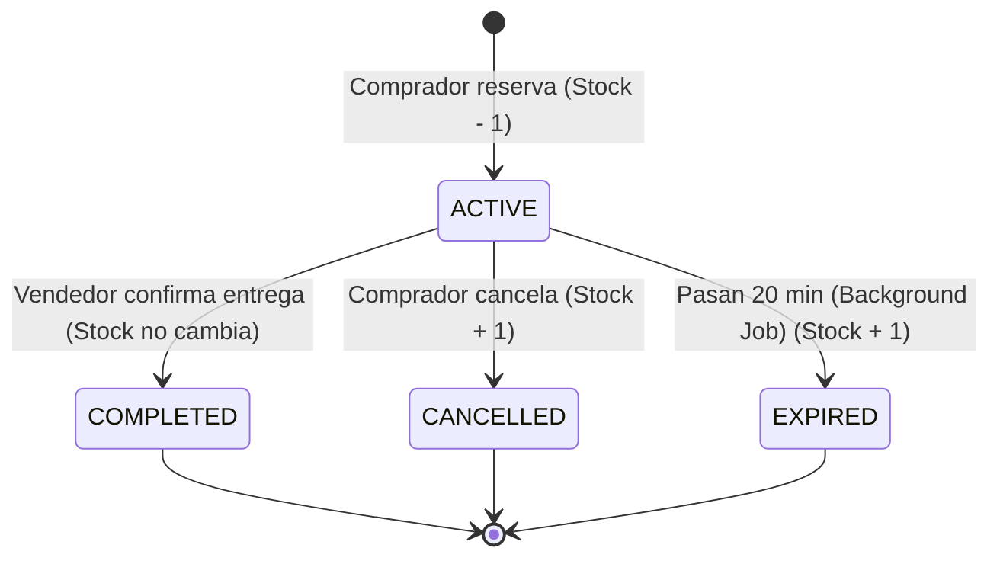

# Especificación de Requerimientos de Software (TapCampus)

Este documento detalla los requerimientos funcionales (RF) y no funcionales (RNF) del sistema TapCampus. Se utiliza una priorización basada en el modelo **MoSCoW** (Must have, Should have, Could have, Won't have).

---

## 1. Requerimientos Funcionales (RF)

### Módulo de Autenticación y Cuentas
*   **RF-01: Registro con Dominio Exclusivo [MUST]**
    *   **Descripción:** El sistema deberá validar que el correo ingresado termine estrictamente en `@uabc.edu.mx` para permitir la creación de la cuenta.
    *   **Criterios de Aceptación:** 
        *   Si un usuario intenta registrarse con un dominio diferente (ej. `@gmail.com`), el sistema deberá mostrar un error y bloquear el registro.
        *   No se requerirá código de verificación vía email; la validación por cadena de texto del dominio es suficiente.
*   **RF-02: Perfil de Usuario [MUST]**
    *   **Descripción:** El sistema deberá requerir de manera obligatoria el ingreso de Nombre, Correo, Contraseña y Teléfono durante el registro.
    *   **Criterios de Aceptación:**
        *   Si falta alguno de los 4 campos, el botón de registro estará deshabilitado.

### Módulo de Publicaciones (Ventas en Vivo)
*   **RF-03: Creación de Publicación en Vivo [MUST]**
    *   **Descripción:** El sistema deberá permitir al vendedor crear una publicación capturando: foto, título, descripción, precio, categoría, stock inicial, lugar y hora de inicio/fin.
    *   **Criterios de Aceptación:**
        *   La publicación debe mostrar un temporizador regresivo calculado entre la hora actual y la hora de fin.
*   **RF-04: Expiración por Tiempo o Stock [MUST]**
    *   **Descripción:** El sistema deberá retirar automáticamente la publicación del feed cuando el temporizador llegue a cero o cuando el stock disponible llegue a cero.
*   **RF-05: Cierre Manual Anticipado [SHOULD]**
    *   **Descripción:** El sistema deberá permitir al vendedor finalizar la publicación manualmente con un solo toque antes de que expire el tiempo.
    *   **Criterios de Aceptación:**
        *   Al presionar el botón de "Finalizar", la publicación desaparece del feed, se bloquean nuevas reservas, pero las reservas activas previas se mantienen intactas.
*   **RF-05b: Ajuste de Venta Física [MUST]**
    *   **Descripción:** El sistema deberá permitir al vendedor restar el stock manualmente con un botón ("-1") si vende el producto a alguien que llegó sin usar la aplicación.
    *   **Criterios de Aceptación:**
        *   Este descuento manual no debe afectar nunca a las piezas que ya están en estado "Reservado".
*   **RF-05c: Filtrado por Zona y Categoría [MUST]**
    *   **Descripción:** El sistema deberá proveer controles visuales para filtrar el feed principal.
    *   **Criterios de Aceptación:**
        *   Los filtros deben combinarse (ej. Mostrar "Snacks" en la "Facultad de Ingeniería").

### Módulo de Publicaciones (Ventas Estáticas)
*   **RF-06: Catálogo Estático [MUST]**
    *   **Descripción:** El sistema deberá permitir la publicación de artículos sin temporizador (libros, materiales).
    *   **Criterios de Aceptación:**
        *   La publicación permanecerá activa indefinidamente hasta que el vendedor cambie su estado a "Vendido".

### Módulo de Reservas y Transacciones
*   **RF-07: Reserva Temporal [MUST]**
    *   **Descripción:** El sistema deberá permitir al comprador apartar una unidad del producto, descontando el stock disponible e iniciando un temporizador de 20 minutos.
    *   **Criterios de Aceptación:**
        *   El comprador solo puede ver el contacto de WhatsApp del vendedor *después* de que la reserva ha sido confirmada por el sistema.
*   **RF-08: Confirmación de Entrega [MUST]**
    *   **Descripción:** El sistema deberá permitir **únicamente al vendedor** confirmar la entrega física del producto mediante un botón en la app.
    *   **Criterios de Aceptación:**
        *   Al confirmar, el stock reservado pasa permanentemente a estado "Vendido".
*   **RF-09: Expiración Automática de Reservas [MUST]**
    *   **Descripción:** El sistema deberá liberar el stock reservado devolviéndolo al inventario disponible si transcurren 20 minutos sin que el vendedor confirme la entrega.
    *   **Criterios de Aceptación:**
        *   Esta validación debe ejecutarse en el servidor (ej. BullMQ/Redis) para ser resistente a cierres de la app o reinicios del servidor.
*   **RF-10: Cancelación por Comprador [SHOULD]**
    *   **Descripción:** El sistema deberá permitir al comprador cancelar su propia reserva antes de los 20 minutos.
    *   **Criterios de Aceptación:**
        *   Al cancelar, el stock se libera inmediatamente para otros compradores.

**📊 Máquina de Estados de la Reserva (Lógica Estricta):**

*(Nota para la IA: El backend debe rechazar cualquier transición no definida en este diagrama, ej. pasar de EXPIRED a COMPLETED es inválido).*

### Módulo de Precios y Ofertas (Precio Ganga)
*   **RF-11: Configuración de Precio Ganga [MUST]**
    *   **Descripción:** El sistema deberá permitir al vendedor definir un "Precio mínimo" y un método de activación (manual o programado) al momento de crear o editar una publicación en vivo.
*   **RF-12: Activación Instantánea [MUST]**
    *   **Descripción:** Al momento de activarse (ya sea por el botón del vendedor o por el job de tiempo), el sistema deberá reemplazar el precio normal por el precio ganga de forma inmediata (sin transiciones graduales).
    *   **Criterios de Aceptación:**
        *   La interfaz de la publicación cambiará para incluir un distintivo visual ("Ganga") y subirá de posición en el feed.

### Módulo de Interacción y Moderación
*   **RF-13: Redirección a WhatsApp (Deep Linking) [MUST]**
    *   **Descripción:** El botón de "Contactar" deberá abrir directamente el chat de WhatsApp utilizando el número del usuario.
    *   **Criterios de Aceptación:**
        *   El formato de la URL debe ser: `https://wa.me/52[NUMERO]?text=Hola,%20tengo%20una%20reserva%20para%20[PRODUCTO]`.
*   **RF-14: Ocultamiento Automático por Reportes [SHOULD]**
    *   **Descripción:** El sistema deberá proteger a la comunidad de publicaciones maliciosas o SPAM.
    *   **Criterios de Aceptación:**
        *   Si una misma publicación acumula **3 reportes** de usuarios distintos, su estado cambiará automáticamente a `HIDDEN_BY_REPORTS` y desaparecerá del feed público hasta que un Moderador la revise.

---

## 2. Requerimientos No Funcionales (RNF)

*   **RNF-01: Concurrencia y Consistencia (Bloqueo Pesimista) [MUST]**
    *   **Descripción:** El sistema deberá manejar peticiones simultáneas de reserva utilizando bloqueos pesimistas en base de datos (`SELECT ... FOR UPDATE`).
    *   **Criterios de Aceptación:**
        *   Si queda 1 pieza en stock y 2 usuarios pulsan "Reservar" en el mismo milisegundo, la base de datos deberá procesar en cascada, otorgando la reserva al primer request y lanzando un error amigable ("Stock agotado") al segundo.
*   **RNF-02: Actualización en Tiempo Real [MUST]**
    *   **Descripción:** El sistema deberá notificar a los clientes sobre cambios en el inventario sin necesidad de que el usuario recargue la pantalla (Pull to refresh).
    *   **Criterios de Aceptación:**
        *   Se usarán WebSockets (Socket.io) para propagar eventos de `stock_actualizado` a los clientes conectados.
*   **RNF-03: Seguridad y Restricciones Físicas [MUST]**
    *   **Descripción:** El sistema no integrará geolocalización satelital (GPS) ni pasarelas de pago (Stripe/PayPal).
    *   **Criterios de Aceptación:**
        *   La ubicación se manejará únicamente por selección de catálogos de zonas predefinidas (Ej. Facultad de Ingeniería, Biblioteca). Todo pago es externo a la app.

---

## 3. Matriz de Priorización (Para Fases de Desarrollo)

| Prioridad | Funcionalidad |
| :--- | :--- |
| **Alta (MVP)** | Autenticación (`@uabc`), CRUD de publicaciones, Bloqueo Pesimista, Reserva de 20 min y expiración por Job, Activación manual de Precio Ganga. |
| **Media** | Filtros por Zonas y Categorías, Cancelación manual del comprador, Activación programada de Precio Ganga, Sockets para tiempo real. |
| **Baja** | Moderación de publicaciones reportadas, Perfil de usuario y edición, Notificaciones Push. |

---

## 4. Estrategia de Pruebas (QA / Testing)
Para garantizar la solidez de las lógicas críticas, se implementarán pruebas automatizadas en el backend:
*   **Prueba de Estrés (Concurrencia):** Se debe crear un script (Unit o E2E test) que dispare 50 peticiones HTTP simultáneas al endpoint `POST /reservations` para un producto con `current_stock: 1`. La prueba se aprueba si **exactamente 1 petición** recibe HTTP 201 (Created) y las **49 restantes** reciben HTTP 409 (Conflict).
*   **Prueba de Expiración:** Se simulará la creación de una reserva y se adelantará el reloj del sistema/Redis para verificar que el job en background devuelva el stock al producto y cambie la reserva a estado `EXPIRED` automáticamente.
